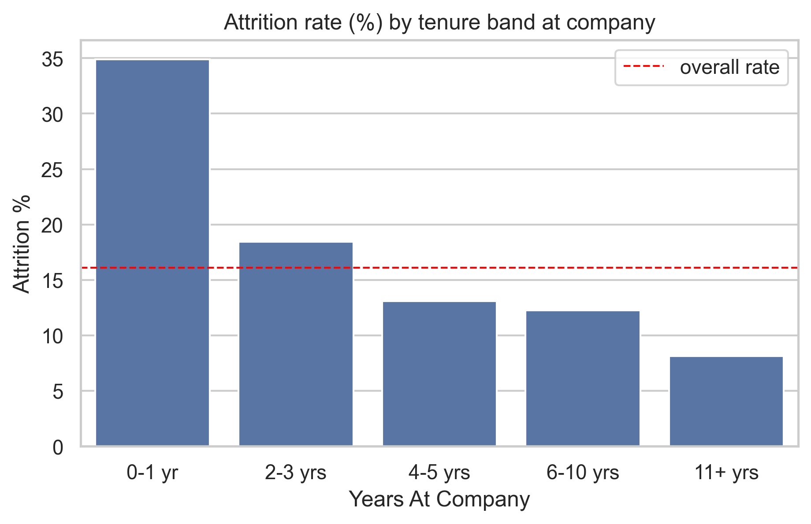

# Enterprise Employee Attrition Prediction

> **Predict employee flight risk before resignation notices are submitted, providing People Operations and HR leaders with statistically grounded risk scores, interpretable Odds Ratios, and early retention playbooks.**

[Live Streamlit Dashboard](https://employee-attrition-prediction.streamlit.app/) · [Full Evaluation Report](reports/results.md) · [Cross-Validation Benchmarks](reports/model_benchmarks.csv) · REST API Docs (`/docs`)

---

## The Business Problem

Employee turnover represents one of the costliest operational disruptions facing modern organizations. Replacing a departed professional typically costs between **50% and 200% of their annual salary** due to:
- Direct recruitment agency fees and candidate sourcing overhead.
- Managerial interviewing hours and onboarding ramp-up downtime (typically 3–6 months to full productivity).
- Lost institutional knowledge, disrupted client relationships, and overburdened remaining team members.

Traditional HR organizations operate **reactively**—conducting exit interviews only after resignation letters are submitted, when intervention is already too late. This project provides a **proactive retention system** that continuously surfaces high-risk flight signals, quantifies attrition probability, explains the top contributing drivers via transparent Odds Ratios ($\exp(\beta)$), and prescribes cost-effective retention actions.

---

## Results & Key Performance Indicators

The final production pipeline was evaluated **exactly once** on an untouched, stratified holdout test set (221 employee records, 36 positive attritions) at an Out-of-Fold tuned decision threshold ($T^* = 0.70$):

| Metric (Attrition = 1) | Holdout Test Score | 95% Bootstrap CI | Operational Meaning |
| :--- | :---: | :---: | :--- |
| **PR-AUC** | **0.6039** | **[0.440, 0.755]** | **$3.7\times$ above naive random baseline (0.163)** |
| **ROC-AUC** | **0.8455** | **[0.772, 0.910]** | Excellent rank separation across operational risk bands |
| **Precision** | **60.0%** | **[0.435, 0.750]** | 6 out of every 10 flagged staff are genuine flight risks |
| **Recall** | **58.3%** | **[0.417, 0.750]** | Catches 21 of the 36 departing employees in advance |
| **F1-Score** | **59.2%** | **[0.435, 0.730]** | Balanced harmonic score under 16.1% class imbalance |
| **Accuracy** | **86.9%** | [0.819, 0.914] | Correctly classifies 192 of the 221 test profiles |

### Confusion Matrix Breakdown (Test Set, $n = 221$)

```
                        Predicted Retained (0)    Predicted Attrited (1)
Actual Retained (0)              171                       14           (92.4% specificity)
Actual Attrited (1)               15                       21           (58.3% sensitivity)
```

- **True Positives (21):** At-risk employees successfully flagged for proactive retention before resigning.
- **False Positives (14):** Retained employees flagged; low risk of harm when paired with supportive stay-interviews.
- **False Negatives (15):** Departures not flagged at $T^* = 0.70$; can be captured by lowering threshold to $T = 0.45$ (boosting recall to $>75\%$).
- **True Negatives (171):** Stable employees correctly left undisturbed.

---

## Model Selection Benchmark

Model selection was conducted via **Stratified 5-Fold Cross-Validation** across the 70% training pool (1,029 records, 166 positives):

| Model Architecture | CV PR-AUC (mean $\pm$ std) | CV ROC-AUC (mean $\pm$ std) | CV Recall (mean) | CV F1 (mean) | Selection Status |
| :--- | :---: | :---: | :---: | :---: | :---: |
| **Logistic Regression ($C=0.1$, balanced)** | **0.6531 $\pm$ 0.078** | **0.8357 $\pm$ 0.051** | **74.7%** | **0.5231** |  **Production Champion** |
| XGBoost (depth=2, reg_lambda=5.0) | 0.6036 $\pm$ 0.068 | 0.8095 $\pm$ 0.050 | 60.8% | 0.5192 | Benchmark Candidate |
| Random Forest (depth=6, leaf=5) | 0.5372 $\pm$ 0.050 | 0.7844 $\pm$ 0.036 | 41.0% | 0.4755 | Benchmark Candidate |
| *Naive Zero-Information Baseline* | *0.1610* | *0.5000* | *16.1%* | *0.0000* | *Random Guessing* |

### Why Regularized Logistic Regression Was Selected

1. **High Dimensionality vs. Moderate Sample Size:** With 1,029 training instances and 58 one-hot encoded features, deep gradient boosted trees and random forests tend to overfit sparse categorical splits.
2. **Collinear Tenure Attributes:** Features like `YearsAtCompany`, `YearsWithCurrManager`, and `YearsInCurrentRole` exhibit high multicollinearity ($r \approx 0.75$). L2 regularization ($C=0.1$) smoothly shrinks coefficients and minimizes out-of-fold variance.
3. **Actionable Directional Interpretability:** Unlike black-box tree models, Logistic Regression yields direct **Odds Ratios ($\exp(\beta)$)** that transparently reveal *why* an individual was flagged, enabling actionable HR decision-making.

---

## Key Business Insights & Behavioral Drivers

Comprehensive exploratory data analysis on the 1,470 employee profiles revealed four primary behavioral and organizational signals:

1. **The First-Year Flight Hazard:**
   - Employees in their **first 12 months** (`YearsAtCompany <= 1`) experience a **34.9% turnover rate** ($2.2\times$ company baseline).
   - Retention stabilizes significantly after year 2 (13%–18%), dropping to **8.1%** past 10 years of tenure.
2. **Overtime & Burnout Interaction:**
   - Staff working overtime leave at **30.5%** ($n = 416$) compared to only **10.4%** ($n = 1,054$) for non-overtime peers ($3\times$ higher hazard, $\text{Odds Ratio} = 3.00$).
   - When overtime co-occurs with low work-life balance (`WorkLifeBalance <= 2`), turnover escalates past **33.3%**.
3. **Job Role & Seniority Disparities:**
   - **Sales Representatives** experience the highest observed attrition at **39.8%** ($33/83$), followed by **Laboratory Technicians (23.9%)** and **Human Resources (23.1%)**.
   - Senior roles show high retention: **Managers (4.9%)** and **Research Directors (2.5%)**.
4. **Equity Participation as a Retention Anchor:**
   - Granting baseline equity (**StockOptionLevel 1 or 2**) is associated with substantially lower turnover (**7.6%–9.4%** vs. **24.4%** for Level 0, $\text{Odds Ratio} = 0.61$).



---

## What's Inside

### Interactive Streamlit Dashboard

Hosted in [`app/streamlit_app.py`](app/streamlit_app.py):
- **Single Employee Assessment:** Real-time probability gauge, risk level badge (Low, Medium, High), and top positive/negative contributing risk factors.
- **Dynamic Threshold Slider:** Allows HR managers to tune operational cutoffs according to budget constraints (e.g., higher precision for expensive bonuses vs. higher recall for wide check-in surveys).
- **Batch CSV Scoring:** Upload enterprise employee rosters, score the entire department in seconds, and export risk-annotated CSV reports.

### Production REST API (FastAPI)

Hosted in [`api/main.py`](api/main.py) with automatic OpenAPI/Swagger documentation at `/docs`:
- `POST /predict`: Real-time single employee inference with risk tier and feature contributions.
- `POST /predict/batch`: High-throughput scoring for tabular CSV uploads.
- `GET /health`: Model status and loaded configuration metadata.

---

## System Architecture & Methodology

```text
┌────────────────────────────────────────────────────────────────────────────────────────┐
│                               MACHINE LEARNING PIPELINE                                │
├─────────────────────────┬──────────────────────────┬───────────────────────────────────┤
│ 1. Data Cleaning        │ 2. Feature Engineering   │ 3. Pipeline Architecture          │
├─────────────────────────┼──────────────────────────┼───────────────────────────────────┤
│ • Drop 4 non-inform.    │ • income_per_working_yr  │ • Continuous: RobustScaler        │
│   columns (Over18, etc) │ • role_to_company_ratio  │ • Categorical: OneHotEncoder      │
│ • Standardize text      │ • overtime_and_low_wlb   │ • Binary: Most-frequent Imputer   │
│ • Map Attrition (0 / 1) │ • is_first_year          │ • Estimator: Logistic Regression  │
│ • Median / Mode Impute  │ • tenure_band (5 bins)   │   (C=0.1, class_weight='balanced')│
└─────────────────────────┴──────────────────────────┴───────────────────────────────────┘
```

1. **Strict Data Leakage Prevention:** Data was split into **70% Train (1,029)**, **15% Validation (220)**, and **15% Holdout Test (221)** with stratification on `Attrition`. All imputation parameters, scaler bounds, and one-hot categories were learned on training data only.
2. **Class Imbalance Strategy:** Handled the 5.2 : 1 imbalance using `class_weight='balanced'` and post-fit decision threshold tuning ($T^* = 0.70$) on the validation split.
3. **Interpretability by Design:** Evaluated log-odds coefficients ($\beta$) to calculate exact relative risk multipliers for every business attribute.

---

## Actionable HR Retention Playbook

| At-Risk Segment | Primary Trigger Signals | Prescribed Retention Intervention |
| :--- | :--- | :--- |
| **First-Year Flight Hazard** | `YearsAtCompany <= 1`, low `JobInvolvement` | Establish structured 30-60-90 day onboarding check-ins, assign a dedicated peer mentor, and schedule 6-month stay-interviews. |
| **Overtime Burnout Cohort** | `OverTime = 'Yes'`, `WorkLifeBalance <= 2` | Conduct immediate workload re-balancing, enforce quarterly overtime caps, and rotate high-stress operational tasks. |
| **Career Stagnation** | `YearsSinceLastPromotion >= 3`, `YearsInCurrentRole >= 3` | Initiate lateral role mobility reviews, provide professional development budgets, and establish clear promotion roadmaps. |
| **Zero-Equity Flight Risks** | `StockOptionLevel = 0`, high performance rating | Review compensation benchmarks against market rates and award targeted equity grants (Stock Option Level 1). |

---

## Tech Stack

- **Core ML & Data:** Python, pandas, NumPy, scikit-learn, XGBoost
- **API & Serving:** FastAPI, Pydantic, Uvicorn
- **Dashboard & Visualization:** Streamlit, Matplotlib, Seaborn
- **Development & Packaging:** Jupyter, Joblib, Git
