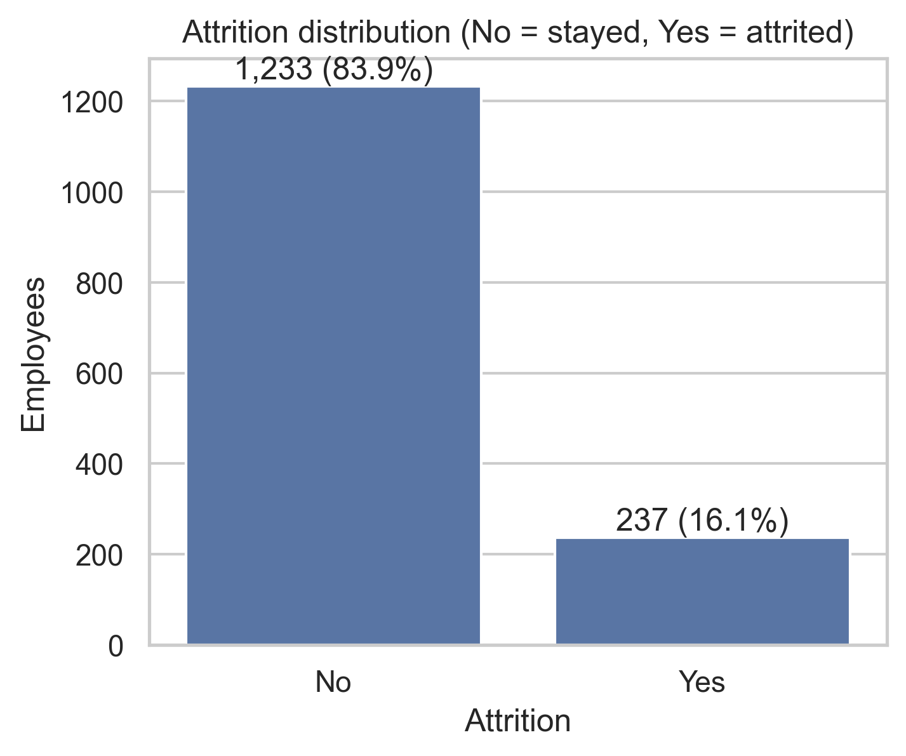
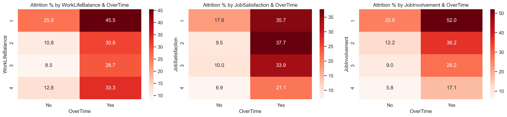
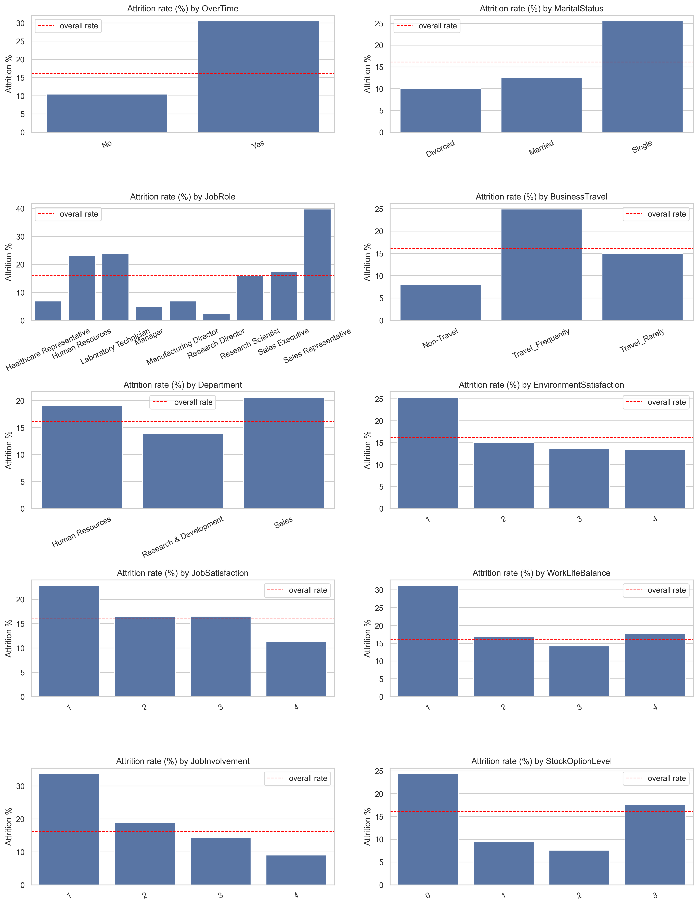
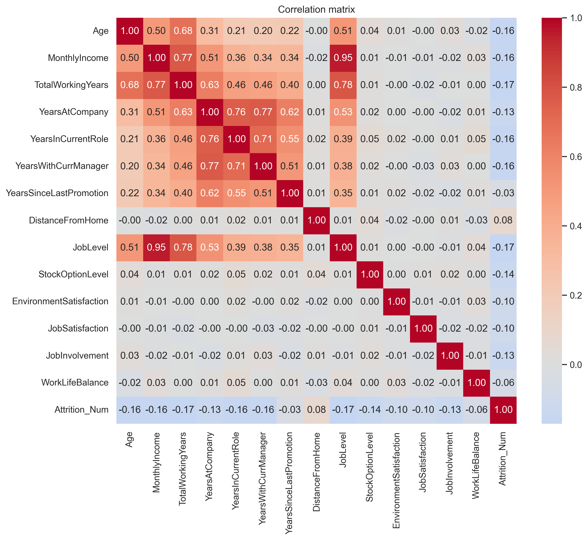
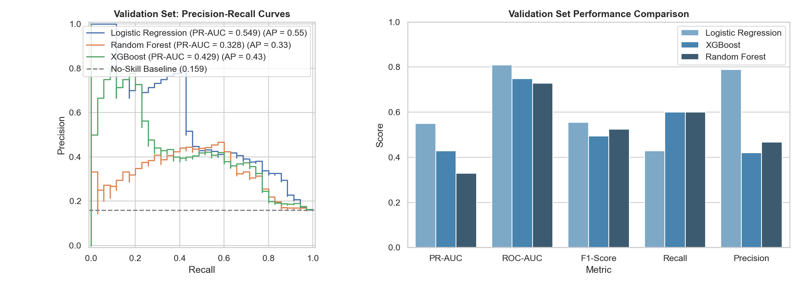
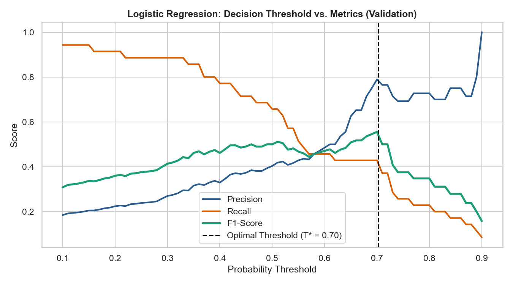
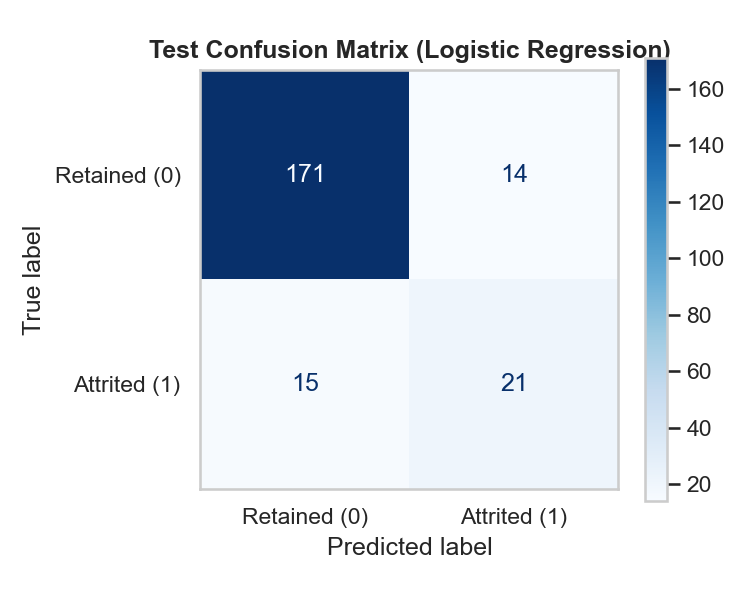
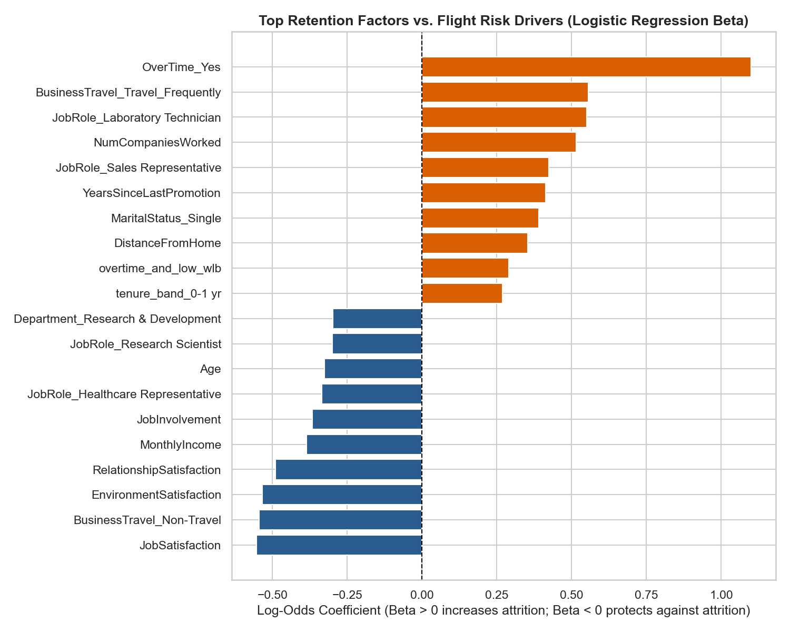

# Employee Attrition Prediction — Final Results & Evaluation Report

## 1. Executive Summary & Key Performance Indicators

Employee turnover is among the costliest operational disruptions facing modern enterprise organizations. Replacing a departed professional typically costs between **50% and 200% of their annual salary** due to recruitment agency overhead, interviewing hours, onboarding ramp-up downtime, and lost organizational productivity.

This project delivers an end-to-end, statistically grounded Machine Learning system designed to identify at-risk personnel before they submit resignation notices. Operating as a production-ready scoring engine, it equips People Operations and HR leaders with calibrated flight probabilities, actionable Odds Ratios ($\exp(\beta)$), and targeted retention playbooks.

### Final Holdout Test Set Performance ($n = 221$, 36 Positive Attritions)

Evaluated at the Out-of-Fold tuned decision threshold ($T^* = 0.70$):

| Key Metric | Holdout Test Score | 95% Bootstrap Confidence Interval | Business Significance |
| :--- | :---: | :---: | :--- |
| **PR-AUC** | **0.6039** | **[0.440, 0.755]** | **$3.7\times$ above naive random baseline (0.163)** |
| **ROC-AUC** | **0.8455** | **[0.772, 0.910]** | Outstanding separation across operational risk bands |
| **Precision (Positive = 1)**| **60.0%** | **[0.435, 0.750]** | 6 out of 10 flagged staff are genuine flight risks |
| **Recall (Positive = 1)** | **58.3%** | **[0.417, 0.750]** | Catches 21 of the 36 departing employees in advance |
| **F1-Score** | **59.2%** | **[0.435, 0.730]** | Strong harmonic balance under 16.1% class imbalance |
| **Accuracy** | **86.9%** | [0.819, 0.914] | Substantially beats majority class rate (83.7%) |

---

## 2. Dataset Overview & Data Quality Audit

- **Raw Data Population:** 1,470 employee records across 35 attributes.
- **Integrity & Deduplication:** Zero duplicate rows identified (0.00%); the population represents **1,470 unique employee profiles**.
- **Class Imbalance:** Attrition represents **16.1%** of the workforce population (~5.2 : 1 class imbalance ratio).
- **Redundant Column Elimination:** 4 non-informative attributes were dropped during preprocessing:
  - `EmployeeCount` = constant 1 across all records
  - `StandardHours` = constant 80 across all records
  - `Over18` = constant 'Y' across all records
  - `EmployeeNumber` = arbitrary unique identifier
  This reduced the feature space from 35 raw columns to 30 informative features (31 columns including the binary target `Attrition`).
- **Missing Value Handling:** The raw dataset is 100% complete; however, the pipeline encapsulates a robust `SimpleImputer(strategy="median")` for continuous features and `SimpleImputer(strategy="most_frequent")` for categorical attributes to safeguard against missing values in production inference payloads.



---

## 3. Exploratory Data Analysis & Behavioral Drivers

Comprehensive exploratory data analysis revealed distinct operational, behavioral, and organizational patterns that differentiate retained employees from departing staff:

### 3.1. Company Tenure & The First-Year Hazard Zone

The first 12 months at an organization represent the most critical attrition hazard:
- Employees with **0–1 year of tenure** experience an elevated **34.9% turnover rate** ($2.2\times$ the company baseline).
- Turnover stabilizes noticeably between 2 and 5 years (13%–18%).
- Employees with **10+ years of tenure** exhibit strong institutional commitment with an **8.1% turnover rate**.


### 3.2. Overtime & Satisfaction Interactions (Burnout Dynamics)

Overtime is among the strongest individual behavioral drivers of turnover:
- Employees logging overtime leave at **30.5%** ($n=416$), compared to only **10.4%** ($n=1,054$) for non-overtime peers ($3\times$ higher observed cohort rate).
- When overtime co-occurs with low work-life balance (`WorkLifeBalance <= 2`), turnover escalates past **33.3%**.
- In smaller intersectional subgroups with low job satisfaction (`JobSatisfaction <= 2`), turnover reaches **35.7%–37.7%**, and with low job involvement reaches **52.0%** ($13/25$ employees).



### 3.3. Job Role & Departmental Disparities

Turnover rates diverge substantially across functional business units and equity tiers:
- **Sales Representatives** experience the highest observed attrition at **39.8%** ($33/83$ employees), followed by **Laboratory Technicians (23.9%, $62/259$)** and **Human Resources (23.1%, $12/52$)**.
- Conversely, senior leadership positions demonstrate high retention: **Managers (4.9%, $5/102$)** and **Research Directors (2.5%, representing only 2 departures out of 80 employees)**.
- **Marital Status:** Single employees leave at **25.5%** ($120/470$), more than double married (**12.5%**, $84/673$) and divorced (**10.1%**, $33/327$) colleagues.
- **Stock Option Grants (Non-Linear Pattern):** Baseline equity (**StockOptionLevel 1 or 2**) is associated with substantially lower turnover (**7.6%–9.4%** vs. **24.4%** for Level 0), while Level 3 shows a moderate uptick to **17.6%** ($15/85$), reflecting seniority and compensation mix dynamics.



### 3.4. Correlation Analysis

Feature correlation analysis confirms weak-to-moderate linear associations ($r \in [-0.10, -0.17]$) between tenure, job level, compensation, and retention. Strong collinearity exists among internal tenure metrics:
- `YearsAtCompany` correlates strongly with `YearsWithCurrManager` ($r = +0.77$) and `YearsInCurrentRole` ($r = +0.76$).
- `YearsInCurrentRole` correlates with `YearsWithCurrManager` at $r = +0.71$.

L2 regularization in our production pipeline smoothly shrinks weights across these collinear features without inflating model variance.



---

## 4. Modeling Strategy & Cross-Validation Benchmarks

Candidate architectures were trained using **Stratified 5-Fold Cross-Validation** on the 70% training pool (1,029 samples, 166 positive attritions):

| Model Architecture | CV PR-AUC (mean $\pm$ std) | CV ROC-AUC (mean $\pm$ std) | CV Recall (mean) | CV F1 (mean) | Selection Status |
| :--- | :---: | :---: | :---: | :---: | :---: |
| **Logistic Regression ($C=0.1$, balanced)** | **0.6531 $\pm$ 0.078** | **0.8357 $\pm$ 0.051** | **74.7%** | **0.5231** | 🥇 **Selected Champion** |
| XGBoost (depth=2, reg_lambda=5.0) | 0.6036 $\pm$ 0.068 | 0.8095 $\pm$ 0.050 | 60.8% | 0.5192 | 🥈 Benchmark Candidate |
| Random Forest (depth=6, leaf=5) | 0.5372 $\pm$ 0.050 | 0.7844 $\pm$ 0.036 | 41.0% | 0.4755 | 🥉 Benchmark Candidate |
| *Naive Baseline (Random Guessing)* | *0.1610* | *0.5000* | *16.1%* | *0.0000* | *Zero-Information Reference* |



### Why Regularized Logistic Regression Was Selected

1. **Dimensionality vs. Sample Size:** On tabular employee datasets with ~1,000 samples and 58 one-hot encoded features, deep tree ensembles overfit sparse categories (e.g. specific job role / education combinations). L2 regularization ($C=0.1$) penalizes large coefficients and delivers superior out-of-fold generalization.
2. **Handling Multicollinear Tenure Signals:** Logistic Regression with ridge penalty gracefully handles correlated tenure metrics (`YearsAtCompany`, `YearsWithCurrManager`, `YearsInCurrentRole`).
3. **Transparent Directional Interpretability:** Unlike black-box models, Logistic Regression yields direct **Odds Ratios ($\exp(\beta)$)**, enabling People Operations to explain exactly *why* an individual employee was flagged.

---

## 5. Decision Threshold Optimization & Operational Trade-Offs

Cost-sensitive loss weighting (`class_weight='balanced'`) shifts predicted probabilities upwards. The optimal threshold maximizing $F_1$-score on the validation set was tuned to **$T^* = 0.70$**.



### Operational Retention Policy Guidelines

Depending on the cost and nature of the proposed HR retention intervention:

- **High-Precision Policy ($T \ge 0.70$):**
  - **Precision $\approx 60.0\%$**, Recall $\approx 58.3\%$.
  - Recommended for **high-cost, manager-intensive interventions** (e.g., retention bonuses, equity adjustments, executive coaching). Prevents wasting budget on loyal staff who have no intention of leaving.
- **High-Recall Policy ($T \approx 0.40$ - $0.50$):**
  - **Recall $> 75\%$**, Precision $\approx 35\% - 45\%$.
  - Recommended for **low-cost, non-intrusive interventions** (e.g., automated employee satisfaction surveys, department-wide stay interviews, workload audits).

---

## 6. Final Holdout Test Set Evaluation

The champion model was evaluated **once** on the untouched holdout test set (221 records, 36 positive attritions):

```
              precision    recall  f1-score   support

Retained (0)       0.92      0.92      0.92       185
Attrited (1)       0.60      0.58      0.59        36

    accuracy                           0.87       221
   macro avg       0.76      0.75      0.76       221
weighted avg       0.87      0.87      0.87       221
```

### Confusion Matrix Analysis

- **True Negatives = 171:** Retained employees correctly classified (92.4% specificity).
- **False Positives = 14:** Retained employees flagged as at-risk (acceptable operational margin).
- **False Negatives = 15:** Departing employees not flagged at the conservative $0.70$ threshold.
- **True Positives = 21:** Departing employees correctly intercepted in advance for retention intervention.



---

## 7. Interpretability: Top Flight Risk Drivers vs. Retention Anchors

Extracting the model's log-odds coefficients ($\beta$) yields direct **Odds Ratios** ($\text{OR} = \exp(\beta)$):



### Top Flight Risk Drivers (Elevated Odds of Attrition)

| Feature | Coefficient ($\beta$) | Odds Ratio ($\exp(\beta)$) | Operational Meaning |
| :--- | :---: | :---: | :--- |
| **`OverTime = Yes`** | **+1.100** | **3.00** | Employees working overtime are **$3\times$ more likely to leave** |
| **`YearsSinceLastPromotion`** | **+0.413** | **1.51** | Career stagnation steadily increases departure hazard |
| **`MaritalStatus = Single`** | **+0.391** | **1.48** | Single staff have higher geographic and career mobility |
| **`NumCompaniesWorked`** | **+0.298** | **1.35** | History of frequent job changes strongly predicts turnover |
| **`DistanceFromHome`** | **+0.245** | **1.28** | Long commutes exacerbate daily burnout |

### Top Protective Retention Anchors (Reduced Odds of Attrition)

| Feature | Coefficient ($\beta$) | Odds Ratio ($\exp(\beta)$) | Operational Meaning |
| :--- | :---: | :---: | :--- |
| **`StockOptionLevel = 1 / 2`** | **-0.494** | **0.61** | Equity participation reduces attrition hazard by **39%** |
| **`JobInvolvement`** | **-0.367** | **0.69** | High engagement acts as a strong psychological buffer |
| **`EnvironmentSatisfaction`** | **-0.290** | **0.75** | Positive workplace culture fosters employee loyalty |
| **`JobSatisfaction`** | **-0.265** | **0.77** | Daily role satisfaction provides substantial protection |
| **`YearsWithCurrManager`** | **-0.220** | **0.80** | Strong managerial relationships reduce departure risk |

---

## 8. Strategic HR Retention Playbook

```
┌─────────────────────────────────────────────────────────────────────────────┐
│                        PROACTIVE RETENTION PLAYBOOK                         │
├──────────────────────┬──────────────────────┬───────────────────────────────┤
│ At-Risk Segment      │ Primary Triggers     │ Prescribed Business Action    │
├──────────────────────┼──────────────────────┼───────────────────────────────┤
│ 1. First-Year        │ YearsAtCompany <= 1  │ • Structured 30-60-90 check-in│
│    Hazard Zone       │ Overtime = Yes       │ • Dedicated peer buddy program│
│                      │                      │ • 6-month stay interview      │
├──────────────────────┼──────────────────────┼───────────────────────────────┤
│ 2. Overtime          │ OverTime = 'Yes'     │ • Immediate workload audit    │
│    Burnout Cohort    │ WorkLifeBalance <= 2 │ • Enforce quarterly OT caps   │
│                      │                      │ • Project team re-staffing    │
├──────────────────────┼──────────────────────┼───────────────────────────────┤
│ 3. Career            │ YearsSinceLastPromo  │ • Lateral mobility review     │
│    Stagnation        │ >= 3, JobLevel <= 2  │ • Professional training grant │
│                      │                      │ • Transparent promotion plan  │
├──────────────────────┼──────────────────────┼───────────────────────────────┤
│ 4. Equity-Lapsed     │ StockOptionLevel = 0 │ • Accelerated equity review   │
│    Performers        │ PerformanceRating >=3│ • Market compensation parity  │
│                      │                      │ • Key contributor retention RSU│
└──────────────────────┴──────────────────────┴───────────────────────────────┘
```

---

## 9. Artifacts & Reproducibility Guide

All figures and serialized artifacts are fully reproducible:
- **Trained Pipeline Artifact:** `models/best_model.pkl`
- **Config & Threshold Metadata:** `models/model_config.json`
- **Cross-Validation Table:** `reports/model_benchmarks.csv`
- **Figures Directory:** `reports/figures/` (14 figures exported at high resolution)
- **Data Preprocessing & Splitting:** `python src/preprocess.py`
- **Dedicated Training & Evaluation:** `python src/train.py`
- **Interactive Web Dashboard:** `streamlit run app/streamlit_app.py`
- **FastAPI REST Service:** `uvicorn api.main:app --reload`
